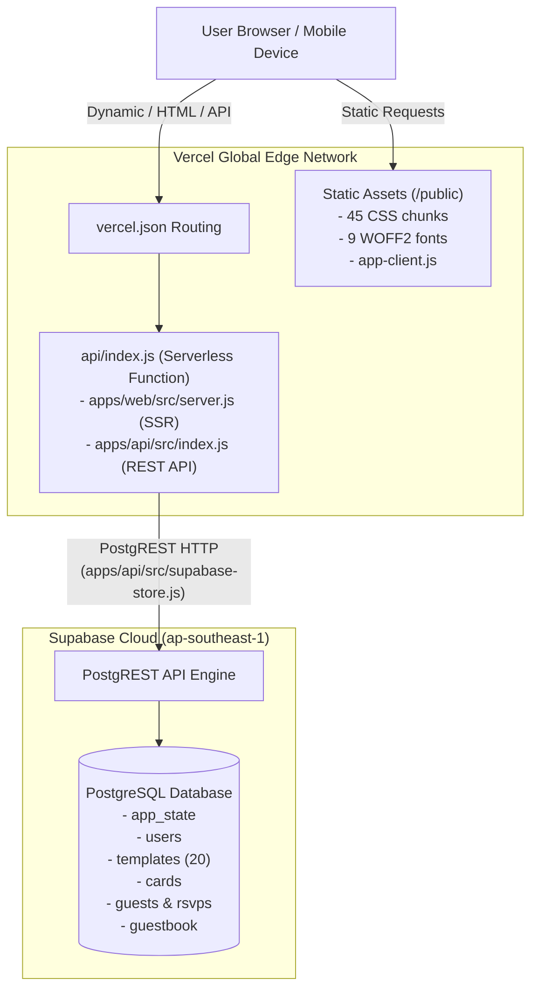
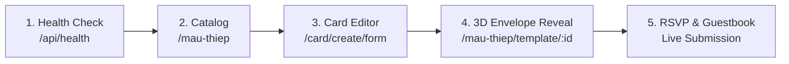

# Comprehensive Deployment Guide: Vercel & Supabase

This guide provides end-to-end instructions for deploying the **NgayChungDoi Wedding Invitation Platform** to **Supabase** (PostgreSQL Database & PostgREST backend) and **Vercel** (Global Serverless & Static Asset Hosting).

---

## 🏛️ System Architecture

---

## 🗄️ Part 1: Supabase Setup (Database & Storage)

### Step 1.1: Create or Open Your Supabase Project
1. Log in to [Supabase Console](https://supabase.com/dashboard).
2. Click **New Project**:
   - **Name**: `wedding-invitation`
   - **Database Password**: Choose a strong password and save it securely.
   - **Region**: Select a region close to your target audience (e.g., `Singapore (ap-southeast-1)` or `Tokyo`).
   - **Pricing Plan**: Free tier is sufficient for standard wedding scale.
3. Wait ~2 minutes for the database cluster to finish provisioning.

---

### Step 1.2: Run Database Schema Migration
The project includes a ready-to-run SQL migration script at:
`supabase/migrations/20261118000000_init_wedding_schema.sql`

1. In your Supabase Dashboard, navigate to **SQL Editor** (icon `>_` on the left sidebar).
2. Click **New query**.
3. Copy and paste the entire contents of `supabase/migrations/20261118000000_init_wedding_schema.sql`:
   - Creates the 7 core tables:
     - `public.app_state` (singleton snapshot for fast hydrations)
     - `public.users` (user accounts & credentials)
     - `public.templates` (20 curated wedding card templates)
     - `public.cards` (custom created cards, bride/groom details, event locations)
     - `public.guests` (guest invite links & QR codes)
     - `public.rsvps` (guest attendance confirmations)
     - `public.guestbook` (wishes & messages from guests)
   - Enables Row Level Security (RLS) with permissive read/write policies for public cards and invitations.
   - Seeds the initial 20 templates and sample cards.
4. Click **Run** (or `Cmd + Enter`).
5. Verify success: Open the **Table Editor** on the left menu and verify that all 7 tables exist and `templates` contains 20 rows.

---

### Step 1.3: Retrieve API Credentials
1. In the Supabase Dashboard, navigate to **Project Settings** (gear icon) $\rightarrow$ **API**.
2. Copy the following two values:
   - **Project URL**: `https://<your-project-ref>.supabase.co`
   - **Project API Keys $\rightarrow$ `anon` / `public`**: A long JWT token starting with `eyJ...`

> [!IMPORTANT]
> Always use the **`anon` `public`** key for runtime application requests. The database RLS policies grant the appropriate permissions without exposing administrative service keys.

---

## ⚡ Part 2: Vercel Setup (Serverless Hosting)

### Step 2.1: Import Your GitHub Repository
1. Log in to [Vercel](https://vercel.com).
2. Click **Add New...** $\rightarrow$ **Project**.
3. Under **Import Git Repository**, find your repository:
   `ngocthoha/wedding-invitation`
4. Click **Import**.

---

### Step 2.2: Configure Build and Project Settings
In the **Configure Project** screen:

| Setting | Value | Notes |
|---|---|---|
| **Project Name** | `wedding-invitation` | Or your preferred subdomain |
| **Framework Preset** | **Other** | Built using zero-dependency Node.js engine |
| **Root Directory** | `./` | Leave default |
| **Build Command** | *Leave empty* (or `npm run check`) | No compilation step required |
| **Output Directory** | *Leave empty* | Vercel uses `vercel.json` and `api/` |
| **Install Command** | `npm install` | Installs runtime dependencies |

---

### Step 2.3: Configure Environment Variables
Expand the **Environment Variables** section and add the following three keys:

| Name | Value | Purpose |
|---|---|---|
| `SUPABASE_URL` | `https://<your-project-ref>.supabase.co` | Supabase PostgREST base endpoint |
| `SUPABASE_ANON_KEY` | `eyJhbGciOi...` | Supabase anonymous public access token |
| `API_BASE` | `/api` | Base path for frontend API calls |

*(Optional)* If you want to use local in-memory fallback during development without Supabase, you can leave these unset; the application will automatically fall back to local seed data.

---

### Step 2.4: Turn Off Deployment Protection (Crucial for Public Wedding Cards)
Because wedding guests need to open wedding invitations without logging into Vercel:
1. In your Vercel Project, go to **Settings** $\rightarrow$ **Deployment Protection**.
2. Under **Vercel Authentication**, ensure it is toggled **Off** (Disabled).
3. If password protection or SSO is enabled, disable it so public guests can freely access `/w/:slug` and `/mau-thiep/template/:id`.

---

### Step 2.5: Deploy
1. Click **Deploy**.
2. Vercel will bundle the project via `vercel.json` and deploy it to a URL like:
   `https://wedding-invitation-<unique>.vercel.app`

---

## 🧪 Part 3: Post-Deployment Verification Checklist

Once the deployment completes, verify the following core flows directly on your production domain:

### Verification Steps:
1. **API Health Check**:
   Open `https://<your-vercel-domain>/api/health`
   - Expected: `{"status":"ok","timestamp":...,"cards":...}`
2. **Template Catalog**:
   Open `https://<your-vercel-domain>/mau-thiep`
   - Expected: Displays 20 wedding templates with filter tabs (Tất cả, Hiện đại, Tối giản, etc.).
3. **Card Creator & Editor**:
   Open `https://<your-vercel-domain>/card/create/form?template=bmmd8nf8vm1i`
   - Expected: Loads the interactive form with 23 accordion panels and a live mobile phone preview.
4. **3D Envelope & Card Reveal**:
   Open `https://<your-vercel-domain>/mau-thiep/template/bmmd8nf8vm1i`
   - Expected:
     - Shows the red `囍` wax seal button ("Chạm để mở thiệp").
     - Clicking seal triggers the 3D envelope fold-open animation.
     - Reveals the complete 12-section card with `data-card-public-ready="true"`.
5. **Interactive RSVP & Guestbook**:
   - Scroll to the bottom of the card.
   - Submit an RSVP confirmation.
   - Post a wish to the Guestbook.
   - Verify that your entry appears on the page and persists in Supabase table `public.rsvps` and `public.guestbook`.

---

## 🔧 Part 4: Custom Domain Setup (Optional)

To use your own wedding domain (e.g., `damcuoi-quan-ha.com` or `thiepcuoi.yourdomain.com`):

1. Go to **Vercel Dashboard** $\rightarrow$ **wedding-invitation** $\rightarrow$ **Settings** $\rightarrow$ **Domains**.
2. Enter your custom domain and click **Add**.
3. In your DNS provider (Cloudflare, Namecheap, GoDaddy, etc.):
   - If using an apex domain (`example.com`), add an **A record**:
     - `A @ 76.76.21.21`
   - If using a subdomain (`wedding.example.com`), add a **CNAME record**:
     - `CNAME wedding cname.vercel-dns.com.`
4. Vercel will automatically provision a free SSL certificate via Let's Encrypt within a few minutes.

---

## 🛠️ Part 5: Maintenance & Troubleshooting

### Issue: "Authentication required to view this deployment"
- **Cause**: Vercel Deployment Protection or Vercel Toolbar is requiring user sign-in.
- **Fix**: Go to Project Settings $\rightarrow$ Deployment Protection $\rightarrow$ Disable "Vercel Authentication".

### Issue: "Card preview shows blank white screen after envelope opens"
- **Cause**: The `data-card-public-ready="true"` attribute is missing on the `<html>` element.
- **Verification**: Ensure `apps/web/src/server.js` renders the public template with `data-card-public-ready="true"`. In our codebase, this is already hard-coded and validated by the test harness.

### Issue: "Supabase data not persisting / fallback to seed data"
- **Cause**: Missing or incorrect `SUPABASE_URL` / `SUPABASE_ANON_KEY` environment variables.
- **Fix**: Check Vercel Project Settings $\rightarrow$ Environment Variables $\rightarrow$ Redeploy the latest commit to apply new variables.
